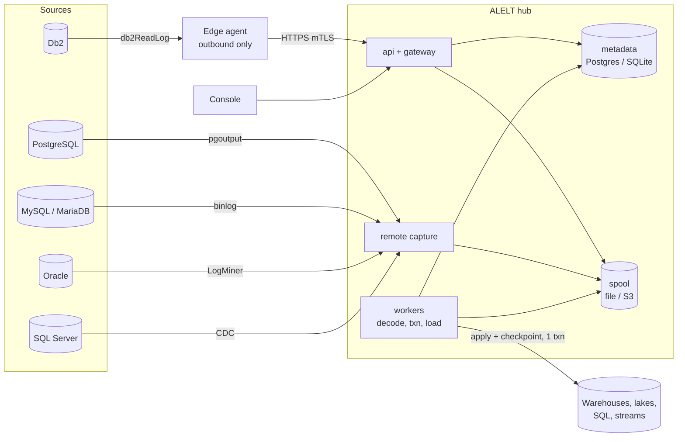

# Universal HA API Log ELT (ALELT)

Open-source, engine-agnostic and cloud-agnostic **change data capture (CDC) / ELT** platform: it reads committed changes from operational databases through their **public log APIs** and applies them with the **data and the checkpoint in one destination transaction** (exactly-once where proven per destination — not yet claimed for Snowflake, see [DESIGN.md §5.3](DESIGN.md#53-exactly-once-status-per-destination)) to warehouses, lakes, SQL databases and streams — standalone on a laptop or highly available on Kubernetes.

> | | |
> |---|---|
> | **1. Licence** | [Apache License 2.0](LICENSE) — free to use, modify and distribute under its terms. |
> | **2. No warranty, no liability** | Provided **"AS IS"**. The authors and contributors accept **no liability** for any damage, data loss or corruption, downtime, costs, or compliance issues. **You** are responsible for testing, backups, approvals and for how you run it — especially against production. See [DISCLAIMER.md](DISCLAIMER.md). |
> | **3. Built exclusively from public information** | Every capture uses only each database vendor's official, publicly documented log / change API (Db2 `db2ReadLog`, PostgreSQL logical decoding / `pgoutput`, MySQL / MariaDB replication protocol, Oracle LogMiner, SQL Server CDC functions) and every destination only its public documented APIs. Built solely from vendors' public documentation and public product information: no reverse engineering (no decompiled, disassembled or traced vendor binaries), no undocumented interfaces, no proprietary or confidential material, no vendor code or headers included; record layouts not spelled out by the documentation were observed on our own test databases and are listed per field in the provenance record. Not affiliated with or endorsed by any vendor; trademarks belong to their owners. See [docs/PUBLIC-APIS.md](docs/PUBLIC-APIS.md) and [docs/legal/PROVENANCE.md](docs/legal/PROVENANCE.md). |

## What it is

| | |
|---|---|
| Capture | log-based, through each engine's public API; **edge agent** (Windows / Linux, outbound-only) or **remote** hub-side capture |
| Delivery | raw batches durable before ACK → decode → transaction assembly (rollbacks never emitted) → apply **+ checkpoint compare-and-set in one destination transaction** (idempotent replay; exactly-once per destination where proven, [status](DESIGN.md#53-exactly-once-status-per-destination)) |
| Safety | read-only on sources, whitelisted agent commands, CPU/memory governor, production deny list, every record classified; quarantine holds the affected table instead of silently diverging |
| Operations | web console (EN / FR / ES / PT-BR), parallel-test wizard, reconciliation and certification, schema drift, rule-based + optional AI diagnosis, Prometheus metrics, audit log |
| Packaging | one container image (`alelt`) + Postgres **or** SQLite metadata; standalone or HA; Helm chart |

## 2-minute quick start

Prerequisite: Docker (Desktop or Engine with compose v2).

**A. Try sources and targets locally (fake data, zero risk)**

```bash
./lab/lab.sh up postgres mysql landing      # Windows: .\lab\lab.ps1 up postgres mysql landing
./lab/lab.sh demo mysql                     # end-to-end demo pipeline, prints PASS/FAIL
./lab/lab.sh down
```

**B. Run the product (hub + console)**

```bash
cd deploy/local
cp .env.example .env                        # set POSTGRES_PASSWORD and an agent token
docker compose up -d                        # project "alelt": postgres, migrate, alelt (api), alelt-worker
# open http://localhost:8080  ->  Setup wizard  ->  New pipeline
```

SQLite single-host variant: `docker compose -f docker-compose.sqlite.yml up -d`. Details: [`lab/README.md`](lab/README.md), [`deploy/local/README.md`](deploy/local/README.md).

## Supported sources and destinations

Status: **stable** = production-proven release line · **beta** = implemented and verified end-to-end in the local test ladder · **planned** = in development or not yet verified against a live engine. Release 0.1 has no *stable* connector yet.

### Sources

| Engine | Public API | Capture | Status | Local lab image |
|---|---|---|---|---|
| IBM Db2 LUW 11.5+ | `db2ReadLog` | edge agent (Windows x64; Linux x64 in development) | beta | `db2` (amd64) |
| PostgreSQL 14+ | logical decoding, `pgoutput` | remote | beta | `postgres` |
| MySQL 8.4 / 9.x | replication protocol (ROW binlog, GTID incl. tagged); JSON columns re-read by key (optional decoder plugin, [JSON-BINARY-PLUGIN.md](connectors/sources/mysql/JSON-BINARY-PLUGIN.md)) | remote | beta | `mysql` |
| MariaDB 10.6+ | replication protocol (ROW binlog) | remote | beta | `mariadb` |
| Microsoft SQL Server 2019+ | CDC table functions | remote | beta | `sqlserver` (amd64) |
| Oracle Database 19c+ | LogMiner | remote | planned | `oracle` |

### Destinations

| Destination | Status | Local lab |
|---|---|---|
| PostgreSQL | beta | `landing` |
| MySQL, MariaDB, SQL Server, Db2, SQLite, DuckDB (generic SQL destination) | beta | `files`, or a source container as target |
| Snowflake | beta (contract-tested with mocks; needs a trial account for live tests) | cloud trial (guidance in console) |
| Oracle (generic SQL) | planned | `oracle` |
| ClickHouse | planned | `clickhouse` |
| Apache Iceberg (REST catalog, S3) | planned | `iceberg` |
| Delta Lake | planned | `delta` |
| Kafka API (Kafka, Redpanda) | planned | `redpanda` |
| Google BigQuery | planned | `bigquery` emulator / sandbox |
| Microsoft Fabric, Amazon Redshift, Databricks | planned | cloud trials (guidance in console) |

## Architecture



More diagrams (components, numbered data flow, HA, deployment, security zones): [`docs/ARCHITECTURE.md`](docs/ARCHITECTURE.md).

## Standalone or HA

| | Standalone | HA |
|---|---|---|
| Hub | 1 api + 1..n workers, one host | N api / worker / capture replicas behind a load balancer |
| Metadata | bundled Postgres or SQLite | external Postgres with HA (managed or self-run) |
| Spool | local volume | S3-compatible object storage |
| Agents | one per source | active / passive pair with capture lease and epoch fencing |
| Install | [`deploy/local/`](deploy/local/) | [`deploy/HA.md`](deploy/HA.md), compose / Swarm or Helm chart (`deploy/helm/`) |
| Switch | `alelt topology plan --to ha` → `apply` (drain, copy spool, migrate metadata, resume) | `--to standalone` |

## Install in a morning

Single Linux VM (any cloud), Docker Swarm, Kubernetes or on-prem, with time-boxed steps: [`deploy/INSTALL-IN-A-MORNING.md`](deploy/INSTALL-IN-A-MORNING.md). Release assets (linux/amd64 images, x64 Windows and Linux agents, Helm chart, SBOM, checksums, signatures): [`deploy/ci/`](deploy/ci/), [`deploy/release/`](deploy/release/).

## Licence & disclaimer

- [Apache License 2.0](LICENSE), © 2026 Freddy Beltran — see also [`NOTICE`](NOTICE).
- Provided "AS IS", no warranty, no liability: [`DISCLAIMER.md`](DISCLAIMER.md).
- Vendor client libraries (e.g. IBM Db2 client, Oracle client) and cloud services are **not included**; obtain them under the vendor's licence.
- Public-API-only statement: [`docs/PUBLIC-APIS.md`](docs/PUBLIC-APIS.md); provenance: [`docs/legal/PROVENANCE.md`](docs/legal/PROVENANCE.md); SPDX policy: [`docs/legal/SPDX.md`](docs/legal/SPDX.md).

## Contributing

- [`CONTRIBUTING.md`](CONTRIBUTING.md) — DCO sign-off, clean-room rule, tests with every change.
- [`CODE_OF_CONDUCT.md`](CODE_OF_CONDUCT.md) · [`GOVERNANCE.md`](GOVERNANCE.md) (maintainer: Freddy Beltran) · [`SECURITY.md`](SECURITY.md) (private vulnerability reporting).
- Design: [`DESIGN.md`](DESIGN.md), ADRs in [`docs/adr/`](docs/adr/), connector SPIs in `connectors/*/_spi/`.
