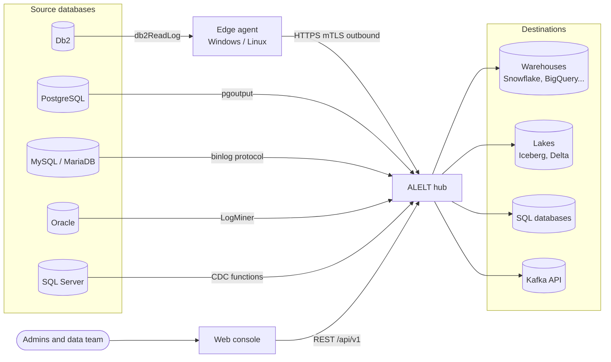
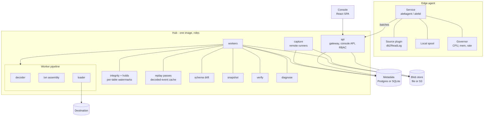
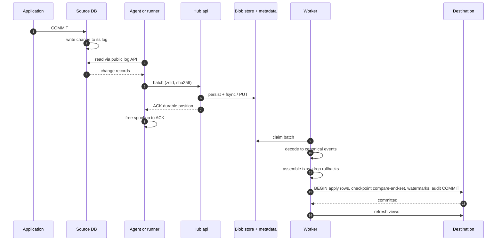
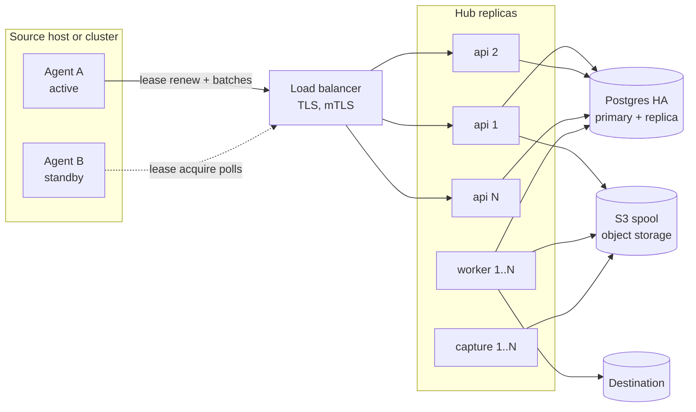
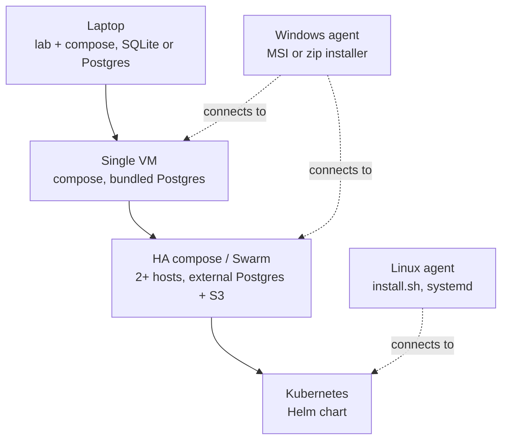
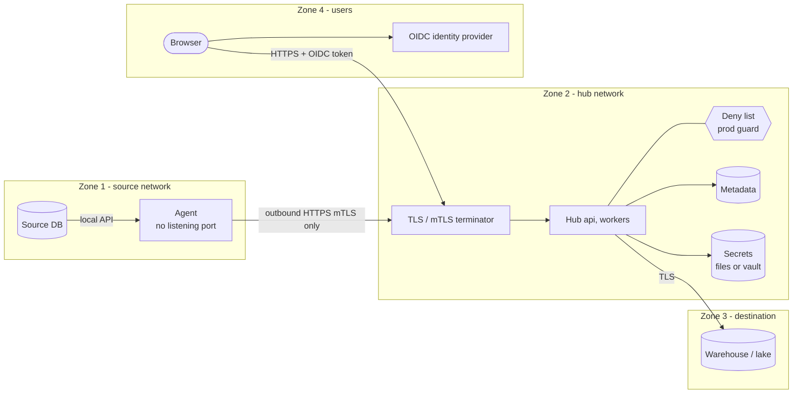

# Architecture

ALELT = engine-agnostic, cloud-agnostic change-data-capture (CDC) and ELT platform. Sources are read only through public log APIs ([`PUBLIC-APIS.md`](PUBLIC-APIS.md)); the core knows only a canonical change model; destinations plug in through an SPI that applies data and checkpoint in one transaction.

| Diagram | Shows |
|---|---|
| [1. Context](#1-context) | who and what talks to ALELT |
| [2. Components](#2-components) | edge agent, hub services, stores, console |
| [3. Data flow](#3-data-flow) | numbered path of one committed change |
| [4. HA topology](#4-ha-topology) | active/passive agents, N hub replicas, Postgres HA, S3 spool |
| [5. Deployment options](#5-deployment-options) | laptop → Kubernetes |
| [6. Security zones](#6-security-zones) | outbound-only agent, mTLS, deny list |

## 1. Context

- **Edge capture** (agent next to the database) when the API is local-only (Db2 `db2ReadLog`).
- **Remote capture** (hub-side runner) when the API is a network protocol (PostgreSQL, MySQL, MariaDB, Oracle, SQL Server).

## 2. Components

| Component | Role |
|---|---|
| Edge agent | Windows C11 service or Linux Python daemon (minimal wheel: daemon + `alelt_common` + one connector): reads raw log records, spools, ships compressed batches, obeys whitelisted commands, self-throttles |
| api | agent gateway (durable receipt, ACK after persistence), console REST API, auth (OIDC), RBAC, setup wizard |
| capture | remote-capture runners for network-protocol sources; same durable receipt as the gateway |
| workers | decode → transaction assembly → load; per-table integrity state + holds (watermarks), multi-table replay passes, snapshot, schema drift, verification, diagnosis jobs; heart-beaten job leases |
| Metadata | PostgreSQL (recommended, HA) or SQLite (single host): config revisions, batches, checkpoints mirror, audit, leases |
| Blob store | raw batches + raw archive (re-decode without touching the source): local filesystem or any S3-compatible store |
| Console | web UI for data team and platform admins, 4 languages |

## 3. Data flow

| # | Guarantee |
|---|---|
| 1–4 | Read-only on the source; nothing is written there. Capture uses the engine's public API only. |
| 5–8 | ACK only after the batch is durable; the agent deletes its spool only up to the ACK (never drops; pauses when full). |
| 9–11 | Every record is classified (decoded / ignored by documented design / signalled). Undecodable records go to quarantine with raw bytes, position and reason and **hold their table** (watermark stops, certification blocked, automatic re-decode / keyed re-read / resync). Rolled-back transactions are never emitted. |
| 12–13 | Rows and checkpoint commit **in one destination transaction**, the checkpoint compare-and-set inside it → exactly-once per destination where proven (see [DESIGN.md §5.3](../DESIGN.md#53-exactly-once-status-per-destination)); replay is idempotent. |
| 14 | Consumers read stable views; per-table switch between a legacy pipeline and ALELT. |

## 4. HA topology

- **Capture lease** per connection (TTL, epoch fencing): only the holder may send batches; a stale epoch gets `423`; the standby takes over after TTL and resumes at the hub's durable position.
- **Hub replicas** are stateless; per-stream worker locks in the metadata database.
- **Spool on S3** so any replica can read any batch. Switch HA ↔ standalone with `alelt topology plan|apply` (see [`deploy/HA.md`](../deploy/HA.md)).

## 5. Deployment options

| Option | Metadata | Spool | Guide |
|---|---|---|---|
| Laptop (evaluation) | SQLite or bundled Postgres | local | [`lab/README.md`](../lab/README.md), [`deploy/local/`](../deploy/local/) |
| Single VM (any cloud / on-prem) | bundled or managed Postgres | local volume | [`deploy/INSTALL-IN-A-MORNING.md`](../deploy/INSTALL-IN-A-MORNING.md) |
| HA compose / Swarm | external Postgres HA | S3-compatible | [`deploy/HA.md`](../deploy/HA.md) |
| Kubernetes | external Postgres | S3-compatible | Helm chart in `deploy/helm/` |
| Agents | — | local spool | [`deploy/agent/`](../deploy/agent/) |

Release images are **linux/amd64**; agents are **x64** (Windows, Linux).

## 6. Security zones

| Control | Detail |
|---|---|
| Outbound only | the agent opens connections to the hub; no inbound port on the database server |
| mTLS + pinned identity | client certificates or one-time enrolment tokens bound to one connection |
| Whitelisted commands | hub → agent: typed commands only (start, pause, resume, limits, catalog, snapshot, probe, shutdown); never arbitrary SQL |
| Deny list | hosts / CIDRs / accounts marked production are refused by the hub and the agent unless explicitly allowed |
| Least privilege | read-only capture users; destination role limited to its schemas |
| Secrets | files / Docker or Kubernetes secrets / vault references; never in config, logs or Git |
| Console | OIDC sign-in, roles Viewer / DataOperator / PlatformAdmin / Auditor, audited two-person rule for switches |
